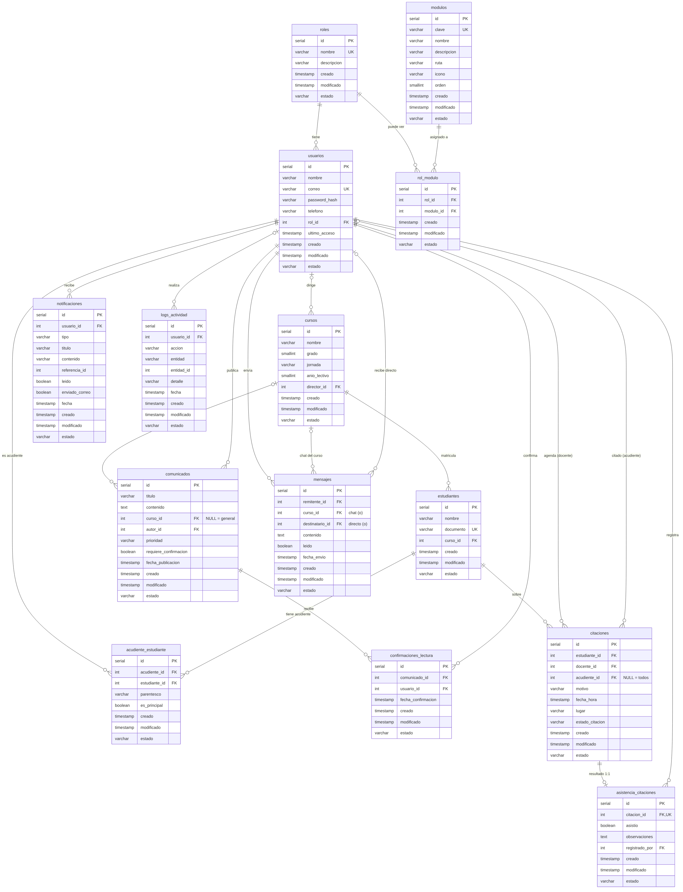

# Conecta Escolar · Comunicación Padres-Colegio en Tiempo Real

Electiva Disciplinar II · Ingeniería de Sistemas, 5.º semestre.

**Problema:** la comunicación con los acudientes se hace por WhatsApp o con circulares en papel, lo que genera desinformación y pérdida de mensajes importantes.

**Solución:** plataforma oficial con circulares digitales y confirmación de lectura, mensajería por curso y directa, calendario de citaciones, notificaciones en tiempo real y reportes.

**Roles:** Coordinación · Docente · Acudiente. El menú de cada rol se carga desde la base de datos (tabla `rol_modulo`).

## Estructura del repositorio

```
comunicacion-colegio/
├── backend/        → API REST (FastAPI + PostgreSQL/Neon) — ver backend/README.md
├── frontend/       → Aplicativo web (SvelteKit + Bootstrap) — ver frontend/README.md
├── docs/           → Diagrama entidad-relación (PNG, PDF, Mermaid)
├── render.yaml     → Despliegue de la API en Render
└── DESPLIEGUE.md   → Paso a paso para publicar en la nube
```

## Tecnologías

| Capa | Tecnología | Nube |
|---|---|---|
| Base de datos | PostgreSQL (14 tablas) | Neon |
| Backend | Python · FastAPI · Pydantic · psycopg2 · JWT · bcrypt · WebSockets | Render |
| Frontend | SvelteKit · Bootstrap 5 · DataTables · Chart.js | Vercel |
| Pruebas | pytest (59 pruebas contra base de datos real) | — |

## Inicio rápido (local)

```bash
# Terminal 1 — API
cd backend
python -m venv venv && venv\Scripts\activate
pip install -r requirements.txt
copy .env.example .env      # pega tu DATABASE_URL de Neon
python -m scripts.init_db
python -m scripts.seed
uvicorn main:app --reload   # → http://127.0.0.1:8000/docs

# Terminal 2 — Frontend
cd frontend
npm install
npm run dev                 # → http://localhost:5173
```

Usuarios de prueba (contraseña `Colegio2026*`): `coordinacion@colegio.edu.co`, `lmartinez@colegio.edu.co`, `maria.rodriguez@correo.com`.


